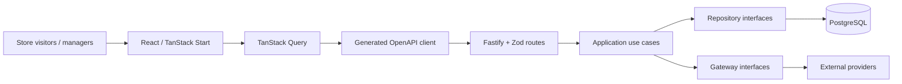

# Mauricio Kwitko

**Senior Software Engineer · Full Stack & Technical Leadership**

React / Next.js · Node.js / Fastify · React Native · System Design · Applied AI

**Florianópolis, Brazil · Available for remote international opportunities**

[Email me](mailto:mauriciokwt@gmail.com) · [Architecture case studies](./docs/ARCHITECTURE_PORTFOLIO.md) · [Portfolio index](#selected-engineering-work)

---

### About me

I am a software engineer with **7+ years of experience** building and evolving web, mobile, and real-time products. My background spans hands-on implementation, architectural decisions, platform refactoring, and mentoring teams.

At Ezoom, I progressed from developer to Tech Lead in nine months and worked on an API redesign that reduced average response time from **3s to 150ms** (20× faster). At B2B Reservas, I have led engineering standards and a core-platform refactor.

I care about **maintainable systems, thoughtful product UX, measurable performance, clear contracts, and pragmatic delivery**.

### Selected engineering work

| Area | Project | What the source demonstrates |
| :-- | :-- | :-- |
| **Full Stack / Frontend** | [Community Storefront — Web](https://github.com/mkwitko/udv-shop) | React 19, TanStack Start, typed OpenAPI clients, SSR data flow, Cloudflare Workers configuration |
| **Backend / Architecture** | [Community Storefront — API](https://github.com/mkwitko/udv-shop-api) | Fastify, Prisma/PostgreSQL, use-case slices, explicit permissions, gateway interfaces, integration tests |
| **Mobile** | [Finance App](https://github.com/mkwitko/finance-app) | React Native, Expo Router, API generation, household and transaction flows, localization |
| **Frontend / Real-Time** | [LunaJoy Frontend](https://github.com/mkwitko/lunajoy-front) | React, TanStack Query, Recharts, Ably events, typed API integration |

**[Explore the architecture behind these projects →](./docs/ARCHITECTURE_PORTFOLIO.md)**

### Engineering specializations

| Frontend & experience | Backend & architecture | Mobile & delivery | Applied AI |
| :-- | :-- | :-- | :-- |
| React, Next.js, TypeScript | Node.js, Fastify, NestJS | React Native, Expo | LLM integrations |
| Design systems, UI/UX | PostgreSQL, Prisma, Zod | Mobile state and navigation | Tool-based agents |
| SSR, performance, testing | OpenAPI, auth, API design | CI/CD, Docker, Cloudflare | Evaluation and media pipelines |

### An architecture I like working with

The public storefront and API illustrate a design approach that keeps UI, generated API contracts, business use cases, and infrastructure responsibilities separate.

**[Implementation notes, trade-offs and code references →](./docs/ARCHITECTURE_PORTFOLIO.md)**

### Engineering beyond public code

I also work on private AI-assisted content tooling with API/tool interfaces, background workers and evaluation pipelines. I can discuss approaches and trade-offs without publishing private implementation details or production data. Public projects above are the primary source-verifiable examples.

### Contact

**Open to:** Senior Frontend, Senior Full Stack, Senior Backend, React Native and Applied AI engineering opportunities.

[mauriciokwt@gmail.com](mailto:mauriciokwt@gmail.com) · Florianópolis, Brazil (UTC−3)

Statements about experience are drawn from my professional CV; technical project descriptions are grounded in the linked source. Production status, usage and quality metrics are not asserted without evidence.
