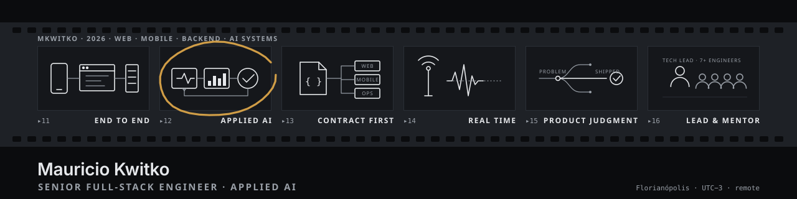

# Mauricio Kwitko

**Senior Full-Stack Engineer · Applied AI**

[mkwitko.github.io/mkwitko](https://mkwitko.github.io/mkwitko/) — portfolio: every frame a real screen, with the stack and one engineering decision per product, plus experience and skills.

I ship web, mobile and backend products end to end, and build LLM pipelines that are measured, cost-aware and kept behind a human review step.
My work is TypeScript throughout: React and React Native clients, Fastify and Node.js APIs, PostgreSQL with Prisma, and contract-first integrations.

**Based in Florianopolis, Brazil (America/Sao_Paulo, UTC-3). Working hours overlap US and European time zones. Open to remote international roles.**

[mauriciokwt@gmail.com](mailto:mauriciokwt@gmail.com)

---

### Selected work

Multi-repository products are grouped by family. Status describes the code in the repository, not a live deployment.

**Applied AI**
- [affiliate-content-factory](https://github.com/mkwitko/affiliate-content-factory): pipeline that turns affiliate offers into reviewed social posts, branded images and narrated Reels, with a human approval queue and an MCP server. TypeScript.
- [aurea-api](https://github.com/mkwitko/aurea-api) · [aurea-web-app](https://github.com/mkwitko/aurea-web-app): backend and React frontend for an AI growth operating system (business context, goals, experiments); the API has an agent runtime with budgets and tracing, credit-based Stripe billing and social publishing.

**E-commerce**
- [ecommerce-api](https://github.com/mkwitko/ecommerce-api) · [ecommerce-storefront](https://github.com/mkwitko/ecommerce-storefront): REST API (orders, donations, raffles, events; Pix and card payments) and web storefront for community stores.

**Mobile and contract-first backend**
- [camisa7-app](https://github.com/mkwitko/camisa7-app) · [camisa7-api](https://github.com/mkwitko/camisa7-api) · [camisa7-web](https://github.com/mkwitko/camisa7-web): React Native app, backend API and public web companion for organizing pickup football (groups, matches, PIX payments, ratings).

**Ambulance fleet management**
- [ambulance-fleet-api](https://github.com/mkwitko/ambulance-fleet-api) · [ambulance-fleet-dashboard](https://github.com/mkwitko/ambulance-fleet-dashboard) · [ambulance-fleet-app](https://github.com/mkwitko/ambulance-fleet-app) · [ambulance-fleet-comms](https://github.com/mkwitko/ambulance-fleet-comms) · [ambulance-fleet-driver](https://github.com/mkwitko/ambulance-fleet-driver): multi-tenant backend, operator console and mobile apps for crew chat, push-to-talk radio, dispatch alerts and QR-code driver check-in.

**Labor-claim calculations**
- [labor-calculations-api](https://github.com/mkwitko/labor-calculations-api) · [labor-calculations-web](https://github.com/mkwitko/labor-calculations-web): multi-tenant API computing Brazilian labor-claim settlements with DataJud docket sync, and a web client with public calculators.

**Field operations**
- [field-operations-tracker-api](https://github.com/mkwitko/field-operations-tracker-api) · [field-operations-tracker-app](https://github.com/mkwitko/field-operations-tracker-app) · [field-operations-tracker-web](https://github.com/mkwitko/field-operations-tracker-web): field data tracking (sessions, preparations, stock per unit and region) with role-based access, a mobile client and a read-only admin panel.
- [planting-geotracker-api](https://github.com/mkwitko/planting-geotracker-api) · [planting-geotracker-app](https://github.com/mkwitko/planting-geotracker-app): offline-first mobile app that registers plantings on a map with averaged GPS coordinates and photos, synced to a REST API.

**Tools and sites**
- [framer-site-capture-plugin](https://github.com/mkwitko/framer-site-capture-plugin): Framer plugin that captures a published website and composes presentation-ready mockups.
- [wedding-rsvp-site](https://github.com/mkwitko/wedding-rsvp-site): wedding website with personal invitation links, RSVP form and a Firebase-backed admin panel.

### Engineering areas

- **Frontend:** React, Next.js, TypeScript, accessible components, TanStack Query.
- **Backend:** Node.js, Fastify, NestJS, PostgreSQL, Prisma, OpenAPI, authentication, integration adapters.
- **Mobile:** React Native, Expo Router, offline-first sync, push notifications.
- **Applied AI:** LLM integrations, orchestration, tool use, evaluation and human-in-the-loop pipelines.
