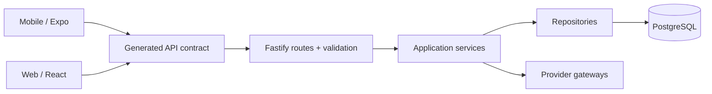

# Mauricio Kwitko

**Senior Software Engineer · Full Stack · Backend · Mobile · Applied AI**

Building products with React, React Native, Node.js and maintainable system architecture.

**Florianópolis, Brazil · Open to remote international roles**

[Engineering portfolio](./docs/index.html) · [Architecture deep dives](./docs/ARCHITECTURE_PORTFOLIO.md) · [Email](mailto:mauriciokwt@gmail.com)

---

### What I do

I have **7+ years** of hands-on engineering experience, including technical leadership, architecture, mentoring and product delivery. My background covers React/TypeScript experiences, Fastify/Node.js APIs, React Native apps, integrations, data contracts and AI-assisted workflows.

At Ezoom, I progressed to Tech Lead within nine months. My professional CV records an API response-time improvement from **3 seconds to 150 milliseconds (20×)**; this result is *not* attributed to any of the public projects below.

### Public work · selected project families

The repositories below are currently public and link to actual source code. Multi-repository products are shown as **systems**, rather than a random set of unrelated repos.

| System | Public implementation | Engineering focus |
| :-- | :-- | :-- |
| **Camisa7 — sports platform** | [Mobile](https://github.com/mkwitko/camisa7-app) · [Backend](https://github.com/mkwitko/camisa7-api) · [Web](https://github.com/mkwitko/camisa7-web) | Expo Router, Fastify/Prisma, React, generated API contracts and test tooling |
| **Sustainability management** | [Web](https://github.com/mkwitko/udv-sus-web) | React, TypeScript, dashboards, reporting and typed data access |
| **Planting platform** | [Backend](https://github.com/mkwitko/udv-plantio-back) | Fastify, Prisma, validation, routes and integration boundaries |
| **Event website** | [React + Firebase project](https://github.com/mkwitko/casamento) | Responsive product experience, registration flows and Firebase integrations |

**[Inspect architectural boundaries, trade-offs and code references →](./docs/ARCHITECTURE_PORTFOLIO.md)**

> The project families above are a **curated public subset**, not a complete inventory of my account. Other systems are being reviewed for safe publication and permission to disclose source. Private implementations, business data and internal access details are deliberately not linked.

### Engineering areas

- **Frontend:** React, Next.js, TypeScript, responsive product UX, accessible components, TanStack Query.
- **Backend:** Node.js, Fastify, NestJS, PostgreSQL, Prisma, OpenAPI, authentication, integration adapters.
- **Mobile:** React Native, Expo Router, API integration, native workflows and animations.
- **Applied AI:** LLM integrations, orchestration, tool use, evaluation and human-in-the-loop pipelines.
- **Delivery:** Docker, CI, contract validation and pragmatic system boundaries.

### How I think about architecture

This is a **conceptual summary of the Camisa7 repository family**, not a verified deployment or performance benchmark. Explore the implementation before drawing conclusions about readiness.

### Contact

Senior Frontend · Full Stack · Backend · React Native · Applied AI engineering

[mauriciokwt@gmail.com](mailto:mauriciokwt@gmail.com) · Remote-friendly, UTC−3

All technical case studies are based on source currently visible in the linked repositories. Live deployment, successful current CI, traffic, adoption and quality metrics must be verified separately.
