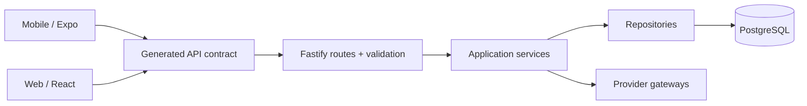

# Mauricio Kwitko

**Senior Software Engineer · Full Stack · Backend · Mobile · Applied AI**

Building products with React, React Native, Node.js and maintainable system architecture.

**Florianópolis, Brazil · Open to remote international roles**

[Engineering portfolio](./docs/index.html) · [Architecture deep dives](./docs/ARCHITECTURE_PORTFOLIO.md) · [Email](mailto:mauriciokwt@gmail.com)

---

### What I do

I have **7+ years** of hands-on engineering experience, including technical leadership, architecture, mentoring and product delivery. My background covers React/TypeScript experiences, Fastify/Node.js APIs, React Native apps, integrations, data contracts and AI-assisted workflows.

At Ezoom, I progressed to Tech Lead within nine months and led a team of more than seven developers. I worked with the founders and product leadership, contributed to hiring, and helped reduce API response time from **3 seconds to 150 milliseconds (20×)**. This result is *not* attributed to any of the public projects below.

At B2B Reservas, I work as a Senior Software Engineer. I reworked the core platform behind the company’s product portfolio and contribute to three new products seen internally as strategic innovation initiatives. I also lead and coach developers in using Claude Code and AI-assisted engineering practices effectively.

I co-founded Prosperapps with a technical mentor and delivered software for football clubs, healthcare companies and content creators, including real-time tools for live content. The venture was later discontinued. I began my career at Embber, a startup in Porto Alegre’s Tecnopuc ecosystem, and later joined Smarte, where I developed a strong foundation in clean code and software architecture.

### Public work · product families

Multi-repository products are shown as **systems**. Private repositories are listed by name only and not linked.

| System | Repositories | Focus |
| :-- | :-- | :-- |
| **AI Content Factory** | [Source](https://github.com/mkwitko/ai-content-factory) | Turns affiliate offers into scripts, images and narrated Reels, with a human review queue and an MCP server. |
| **E-commerce** | [Storefront](https://github.com/mkwitko/ecommerce-storefront) · [API](https://github.com/mkwitko/ecommerce-api) | Community storefront for products, events, campaigns, raffles and donations, with a REST API handling orders and Pix or card payments. |
| **Labor-Claim Calculations** | [API](https://github.com/mkwitko/labor-calculations-api) · Web (private) | Multi-tenant API that computes Brazilian labor-claim settlements and manages cases with DataJud docket sync, plus a web client with public calculators. |
| **Ambulance Fleet Management** | [Comms app](https://github.com/mkwitko/ambulance-fleet-comms) · [Driver app](https://github.com/mkwitko/ambulance-fleet-driver) · API (private) · App (private) · Dashboard (private) | Fleet operations platform: tenant backend, operator console, and mobile apps for crew chat, push-to-talk radio, dispatch alerts and driver check-in by QR code. |
| **AI Growth OS** | API (private) · Web app (private) | Growth operating system with business context, goals, strategies and experiments; the backend adds an agent runtime with budgets and tracing, credit billing and social publishing. |
| **Planting Geolocation** | [App](https://github.com/mkwitko/planting-geotracker-app) · [API](https://github.com/mkwitko/planting-geotracker-api) | Offline-first mobile app that registers plantings on a map with averaged GPS coordinates and photos, synced to a REST API with centre-scoped access. |
| **Field Data Tracking** | [App](https://github.com/mkwitko/accounting-management-app) · [Web](https://github.com/mkwitko/accounting-management-web) · API (private) | Field data tracking system: a mobile app to record preparations, sessions and stock per unit, a read-only admin panel with reports by region, and a backend with role-based access. |
| **Camisa7 · Pickup Football** | [Mobile](https://github.com/mkwitko/camisa7-app) · [API](https://github.com/mkwitko/camisa7-api) · [Web](https://github.com/mkwitko/camisa7-web) | Organizer for pickup football: groups, matches, presence, PIX payments, ratings and rankings, with a public web companion for invites and player profiles. |
| **Framer Plugin** | [Source](https://github.com/mkwitko/framer-site-capture-plugin) | Framer plugin that captures a published website and composes presentation-ready portfolio mockups. |
| **Event Website** | [Source](https://github.com/mkwitko/casamento) | Event website with personal invitation links, RSVP form and an admin panel. Personal data is not republished here. |

**[Inspect architectural boundaries, trade-offs and code references →](./docs/ARCHITECTURE_PORTFOLIO.md)**

### Engineering areas

- **Frontend:** React, Next.js, TypeScript, responsive product UX, accessible components, TanStack Query.
- **Backend:** Node.js, Fastify, NestJS, PostgreSQL, Prisma, OpenAPI, authentication, integration adapters.
- **Mobile:** React Native, Expo Router, API integration, native workflows and animations.
- **Applied AI:** LLM integrations, orchestration, tool use, evaluation and human-in-the-loop pipelines.
- **Delivery:** Docker, CI, contract validation and pragmatic system boundaries.

### How I think about architecture

This is a **conceptual summary of the Camisa7 repository family**, not a verified deployment or performance benchmark. Explore the implementation before drawing conclusions about readiness.

### GitHub activity

<picture>
  <source media="(prefers-color-scheme: dark)" srcset="https://github-readme-stats.vercel.app/api?username=mkwitko&show_icons=true&hide_border=true&theme=github_dark" />
  
</picture>
<picture>
  <source media="(prefers-color-scheme: dark)" srcset="https://github-readme-stats.vercel.app/api/top-langs/?username=mkwitko&layout=compact&hide_border=true&theme=github_dark" />
  
</picture>

Counts cover public repositories only; most client and employer work is private.

### Contact

Senior Frontend · Full Stack · Backend · React Native · Applied AI engineering

[mauriciokwt@gmail.com](mailto:mauriciokwt@gmail.com) · Remote-friendly, UTC−3

All technical case studies are based on source currently visible in the linked repositories. Live deployment, successful current CI, traffic, adoption and quality metrics must be verified separately.
