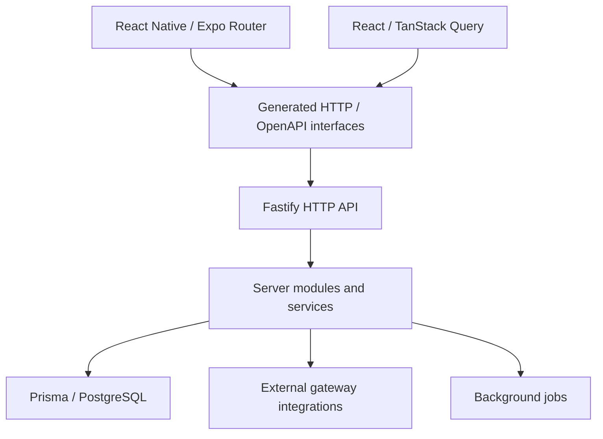

# Architecture portfolio — selected systems

Architecture notes for publicly inspectable projects in this professional portfolio. **The diagrams summarize code structure; they are not assertions about production topology, uptime or real performance.**

## 1. Camisa7: mobile + web + backend boundaries

**Public source:** [React Native app](https://github.com/mkwitko/camisa7-app) · [Backend API](https://github.com/mkwitko/camisa7-api) · [React web app](https://github.com/mkwitko/camisa7-web)

### Source evidence and design implications

| Responsibility | Evidence | Engineering trade-off |
| --- | --- | --- |
| Mobile navigation and native integrations | [Mobile app routes](https://github.com/mkwitko/camisa7-app/tree/master/src/app) | Platform-specific behavior and runtime permissions |
| Frontend state and generated bindings | [Web client](https://github.com/mkwitko/camisa7-web/tree/master/src/api) | Contract generation must remain synchronized |
| Typed API and explicit server boundary | [Backend HTTP modules](https://github.com/mkwitko/camisa7-api/tree/master/src/http) | Consistent validation and authorization across routes |
| Provider isolation | [Gateways](https://github.com/mkwitko/camisa7-api/tree/master/src/gateways) | Abstraction reduces coupling but increases maintenance cost |
| Background processing | [Jobs](https://github.com/mkwitko/camisa7-api/tree/master/src/jobs) | Requires reliable retry, idempotency and observability |

**How to inspect:** follow a read/write interaction from one of the mobile/web routes through a generated HTTP client into the backend HTTP layer and service. Review tests and logs before claiming reliability.

## 2. E-commerce: storefront and API

**Public source:** [ecommerce-storefront](https://github.com/mkwitko/ecommerce-storefront) · [ecommerce-api](https://github.com/mkwitko/ecommerce-api)

A web storefront for community stores (products, events, campaigns, raffles, donations) backed by a REST API for stores, products, orders and donations, with payment by Pix (Woovi) or card (Stripe), per the repository descriptions.

**Trade-offs to evaluate:** payment webhook idempotency, order state transitions, authorization per store, and provider isolation.

## 3. Planting geolocation: offline-first app and API

**Public source:** [planting-geotracker-app](https://github.com/mkwitko/planting-geotracker-app) · [planting-geotracker-api](https://github.com/mkwitko/planting-geotracker-api)

An offline-first mobile app registers plantings on a map with averaged GPS coordinates and photos, synced to a REST API that stores geolocated plant records with centre-scoped access.

**Trade-offs to evaluate:** offline sync conflicts, upload security, permissions and data integrity.

## 4. Event website: product experience and privacy

**Public source:** [casamento](https://github.com/mkwitko/casamento)

React, routing and Firebase configuration support an event website. Its [README](https://github.com/mkwitko/casamento/blob/master/README.md) and [design guide](https://github.com/mkwitko/casamento/blob/master/DESIGN.md) describe product decisions and QA.

**Portfolio rule:** never republish guest information, phone numbers, RSVP contents, personal photographs or location/event details into case studies unless explicitly approved. Public source does not imply permission to redistribute every asset or data item.

## What is not asserted

The following require independent evidence before addition: number of users, revenue, availability, p95 latency, test coverage, security certification, production scale, app store releases and screenshot accuracy.

## Next evidence to collect

- [ ] Permission to feature employer/client/association-owned systems and brand assets.
- [ ] Complete secret scanning of Git history and remediation of historical credentials.
- [ ] Real anonymized screenshots/demo accounts for each public system.
- [ ] Successful, reproducible CI results and build/test commands.
- [ ] Measured results with methods/environment.
- [ ] Safe disclosure reviews before converting any currently private repository.

## Other product families

Further families are listed in the [README](../README.md): AI content factory ([ai-content-factory](https://github.com/mkwitko/ai-content-factory)), labor-claim calculations ([labor-calculations-api](https://github.com/mkwitko/labor-calculations-api)), ambulance fleet management ([comms](https://github.com/mkwitko/ambulance-fleet-comms), [driver](https://github.com/mkwitko/ambulance-fleet-driver)), field data tracking ([app](https://github.com/mkwitko/accounting-management-app), [web](https://github.com/mkwitko/accounting-management-web)) and a [Framer plugin](https://github.com/mkwitko/framer-site-capture-plugin). Private repositories are not linked.
