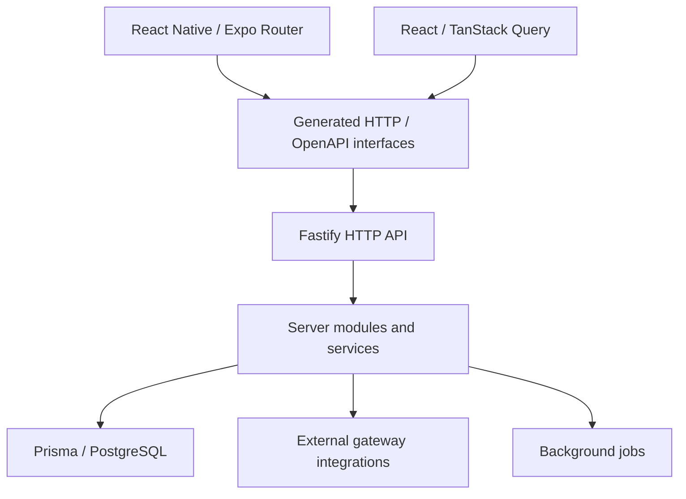

# Architecture portfolio — selected systems

Architecture notes for publicly inspectable projects in this curated professional portfolio. **The diagrams summarize code structure; they are not assertions about production topology, uptime or real performance.**

## 1. Camisa7: mobile + web + backend boundaries

**Public source:** [React Native app](https://github.com/mkwitko/futebol-app) · [Backend API](https://github.com/mkwitko/futebol-back) · [React web app](https://github.com/mkwitko/futebol-web)

### Source evidence and design implications

| Responsibility | Evidence | Engineering trade-off |
| --- | --- | --- |
| Mobile navigation and native integrations | [Mobile app routes](https://github.com/mkwitko/futebol-app/tree/master/src/app) | Platform-specific behavior and runtime permissions |
| Frontend state and generated bindings | [Web client](https://github.com/mkwitko/futebol-web/tree/master/src/api) | Contract generation must remain synchronized |
| Typed API and explicit server boundary | [Backend HTTP modules](https://github.com/mkwitko/futebol-back/tree/master/src/http) | Consistent validation and authorization across routes |
| Provider isolation | [Gateways](https://github.com/mkwitko/futebol-back/tree/master/src/gateways) | Abstraction reduces coupling but increases maintenance cost |
| Background processing | [Jobs](https://github.com/mkwitko/futebol-back/tree/master/src/jobs) | Requires reliable retry, idempotency and observability |

**How to inspect:** follow a read/write interaction from one of the mobile/web routes through a generated HTTP client into the backend HTTP layer and service. Review tests and logs before claiming reliability.

## 2. Sustainability management: web UI and domain workflows

**Public source:** [udv-sus-web](https://github.com/mkwitko/udv-sus-web)

- [Dashboard](https://github.com/mkwitko/udv-sus-web/blob/main/src/pages/dashboard.tsx)
- [Inventory](https://github.com/mkwitko/udv-sus-web/blob/main/src/pages/estoque.tsx)
- [Preparation flows](https://github.com/mkwitko/udv-sus-web/blob/main/src/pages/preparos.tsx)
- [Reporting](https://github.com/mkwitko/udv-sus-web/blob/main/src/pages/relatorios.tsx)
- [API generation configuration](https://github.com/mkwitko/udv-sus-web/blob/main/orval.config.ts)

This repo demonstrates a React/TypeScript UI with multiple operational domains and a generated data-client approach. Other components of this family are intentionally not linked while privacy and ownership checks remain open.

**Trade-offs to evaluate:** query consistency, authorization on mutations, domain isolation, multi-role navigation, operational edge cases, accessibility and error recovery.

## 3. Planting platform: route-driven Fastify API

**Public source:** [udv-plantio-back](https://github.com/mkwitko/udv-plantio-back)

- [Authentication](https://github.com/mkwitko/udv-plantio-back/blob/main/src/routes/authentication-route.ts)
- [Planting records](https://github.com/mkwitko/udv-plantio-back/blob/main/src/routes/plants.ts)
- [Plant types](https://github.com/mkwitko/udv-plantio-back/blob/main/src/routes/plant-type.ts)
- [Planting calendar](https://github.com/mkwitko/udv-plantio-back/blob/main/src/routes/plantation-calendar-date.ts)
- [Uploads](https://github.com/mkwitko/udv-plantio-back/blob/main/src/routes/upload-route.ts)

The code offers useful examples of route boundaries, schema validation and data workflows. Mobile and web variants must not be treated as public until approved.

**Trade-offs to evaluate:** file-upload security, permissions, schema evolution, date/time logic, data integrity and storage lifecycle.

## 4. Event site: product experience and privacy

**Public source:** [casamento](https://github.com/mkwitko/casamento)

React, routing and Firebase configuration support an event website. Its [README](https://github.com/mkwitko/casamento/blob/master/README.md) and [design guide](https://github.com/mkwitko/casamento/blob/master/DESIGN.md) describe product decisions and QA.

**Portfolio rule:** never republish guest information, phone numbers, RSVP contents, personal photographs or location/event details into case studies unless explicitly approved. Public source does not imply permission to redistribute every asset or data item.

## What is not asserted

The following require independent evidence before addition: number of users, revenue, availability, p95 latency, test coverage, security certification, production scale, app store releases and screenshot accuracy.

## Next evidence to collect

- [ ] Permission to feature employer/client/association-owned systems and brand assets.
- [ ] Complete secret scanning of Git history and remediation of historical credentials.
- [ ] Real anonymized screenshots/demo accounts for each public system.
- [ ] Successful, reproducible CI results and build/test commands.
- [ ] Measured results with methods/environment.
- [ ] Safe disclosure reviews before converting any currently private repository.
